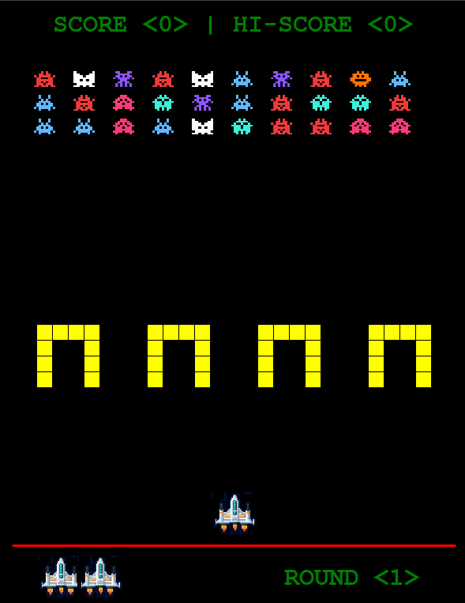

# Space Invaders Game

**A simple Python implementation of the Space Invaders game using custom image-based shapes.**



## Project Structure
- `spaceship.py` Creates and handles the player's spaceship.
- `invaders.py` Creates and handles aliens and the mystery UFO.
- `bunkers.py` Creates and manages bunkers.
- `shapes.py` Converts and adjusts images into shapes for the game screen.
- `main.py` Runs the game loop.
- `board.py` Loads the recorded highest score and tracks and displays scores and rounds.


## Features
- Displays scores and rounds.
- Saves the highest score in a `.txt` file.
- Player wins after completing 10 rounds of alien attacks.
- Aliens move left and right as a group, advancing toward the shooter by shifting downward.
- Aliens' movement speed increases slightly after each round.
- A mystery UFO worth 50 points appears each time 10 aliens are eliminated.
- The player's spaceship is partially protected by defense bunkers.
- The bunkers are destroyed by shots from both the aliens and the spaceship.
- The game ends after all 3 lives of the player are depleted.
- The game ends if the aliens reach the bottom of the screen.


## Technologies
- Python 3
- Turtle Graphics
- `time` module
- `glob` module
- `random` module


## Concepts Practiced
- Object-Oriented Programming (OOP)
- Adding customized shapes to a Turtle screen
- Game loop implementation
- Collision detection
- Managing game state
- Reading and writing files


## How to Run
```bash
python main.py
```